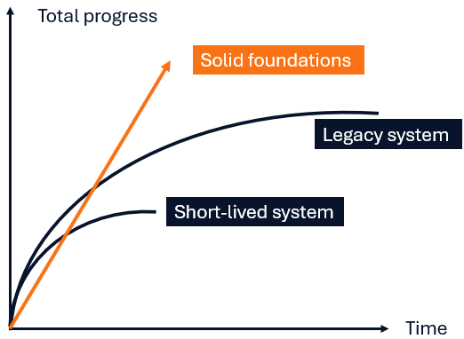

# Chapter 01: Introduction

Operations research creates business value by helping organizations make better decisions. That
value reaches the business through **decision-support software**: software that runs repeatedly to
turn data, mathematical models, and business rules into recurring decisions. This book starts where
a company already has such a decision: a recurring business problem it has chosen to solve with
operations research. It is about how a team takes that problem to decisions the business uses, and
keeps them good while the software and the business change.

---

## 1. Decision-support software

Operations research turns data, business needs, and mathematics into a decision. Training and
literature in the field concentrate on the first half of that sentence: how to formulate a problem,
and how to solve it. What happens to the decision afterwards (who runs the model next month, on
which machine, with whose data) gets far less attention.

Some example problems that require a decision recurrently are:

- Planning the annual extraction of resources from a mine.
- Building the monthly shift schedules of a retail store.
- Recovering the daily operation from a weather disruption in an airline.

These recurring decisions require software to be executed, and they can be classified as special
type of software, a [decision-support system](../appendix/glossary.md#decision-support-system).
Because decision-support software runs on a cadence rather than ending at a deliverable, it must be
maintained, tested, deployed and evolved just as any other important software.

---

## 2. What goes wrong, and why

Decision-support software often has weak software engineering practices, especially in the
components surrounding the mathematical model. Some examples are:

- Usage of jupyter notebooks.
- Absence or lack of automated tests.
- Manual steps to deploy the application.

What are the consequences? The same ones that follow in any other software built with poor
practices:

- Code works on one machine but is difficult to reproduce elsewhere.
- Systems are difficult for peers, and even for their original authors, to maintain or extend.
- Developers are afraid of modifying the system because the consequences are unpredictable.
- Applications eventually need to be rewritten rather than evolved.

Why do we introduce unproper practices in decision-support software? Following the framing by
[Kanewala & Bieman (2014)](https://doi.org/10.1016/j.infsof.2014.05.006) for scientific software:
cultural and technical reasons.

### Cultural reasons

Operations research scientists are trained deeply in mathematics, but rarely in software
engineering, and often do not see why the practices should apply to them. The consequence is visible
in the literature. [Ackoff (1979)](https://doi.org/10.1057/jors.1979.22) already observed operations
research becoming identified with its models rather than with implementing and maintaining them.
[Vidoni (2021)](https://doi.org/10.1080/01605682.2020.1865848) argues the field needs an "Operations
Research Engineering" practice of its own.
[Vidoni & Cunico (2022)](https://doi.org/10.1007/s12532-022-00225-1) surveyed 168 modellers and
found [technical debt](../appendix/glossary.md#technical-debt) in code and documentation to be
widespread and, in most cases, introduced deliberately. The last finding is the one that matters for
a manager: the debt is not an accident of ignorance, it is a choice made under delivery pressure.

### Technical reasons

A decision-support system is a mixture of two disciplines (operations research and software
engineering), and the mixture raises new questions that are not obvious to answer. For example:

- How to automatically test an optimization model?
- How to design a decision-support system to be solver-agnostic?
- How should we design an experimentation platform to assess model changes?

### What is the cost

What does weak engineering cost, in practice? Short answer: business value.

Think of a system's total progress, features delivered, decisions supported, questions the business
can now ask, against time. In
[_A Philosophy of Software Design_](https://web.stanford.edu/~ouster/cgi-bin/aposd.php), John
Ousterhout distinguishes [tactical programming](../appendix/glossary.md#tactical-programming),
focused on finishing the current task quickly while deferring design improvements, from
[strategic programming](../appendix/glossary.md#strategic-programming), which invests in design to
support future changes. [2. What design is for](../03-design/README.md#ch-design-purpose) in Chapter
03 develops how that investment applies to a decision-support system.

The following figure uses that definition to show what I have seen in the industry regarding
decision-support software:

1. **Short-lived system.** The system has working code and delivers business value, but on very weak
   foundations. Within about a year the system cannot absorb the changes the business asks for, and
   the organization rewrites it or decommissions it.
2. **Legacy system.** The system provides business value over some years, but at some point the
   foundations weaken. Either the original developers left, or maybe the engineering practices
   stopped. In the medium term the system becomes a "legacy system": it becomes difficult to
   maintain and extend. Progress stalls.
3. **Solid foundations.** Following a strategic programming approach the system may take slight more
   time to progress than other others, but soon the investments start to pay off to sustain speed in
   the long run. The system is easy to maintain and extend.

  

> [!NOTE]
>
> The curves are illustrative, after Ousterhout (2018): an ordering, not measured data.

---

## 3. DecisionOps

Other communities have met this problem before. When machine learning models began to run in
production, teams found that a model which worked in a notebook decayed in operation. They did not
build a discipline from scratch: they extended [DevOps](../appendix/glossary.md#devops), the
practices that let software teams change a running system quickly and safely, to models.
[Kreuzberger, Kühl and Hirschl (2023)](https://doi.org/10.1109/ACCESS.2023.3262138) describe the
result, [machine learning operations (MLOps)](../appendix/glossary.md#mlops). Data teams did the
same for analytics pipelines with [DataOps](../appendix/glossary.md#dataops)
([Ereth, 2018](https://ceur-ws.org/Vol-2191/paper13.pdf)), and teams building on large language
models are doing it again with large language model operations (LLMOps).

Decision-support software is another such kind of software, with difficulties of its own: the
correct answer of its model is hard to know in advance, a run can end without a feasible plan, and a
decision can be correct and still go unused. It has had no equivalent discipline.
[DecisionOps](../appendix/glossary.md#decisionops) is that extension:

> DecisionOps applies the Three Ways of DevOps (flow, feedback, and continual learning and
> experimentation) to decision-support software. In this book, that means optimization-based
> decision software, heuristics included, taken from a recurring business problem to decisions that
> are used and evaluated, with data and predictive models treated as inputs through explicit
> interfaces.

The [Three Ways](../appendix/glossary.md#three-ways) are the principles Kim, Humble, Debois and
Willis (2016) use to organize DevOps, in chapters 2 to 4 of _The DevOps Handbook_:

- **Flow:** move small changes quickly and safely from the people who build the system to the people
  who use it.
- **Feedback:** see what the running system does, soon enough to act on it.
- **Continual learning and experimentation:** turn what the team learns, failures included, into the
  way it works.

[Chapter 02](../02-lifecycle/README.md) shows what each Way asks of decision-support software.

Practitioners already use the term DecisionOps for the work of putting decision models into
operation ([Nextmv, 2024](https://www.nextmv.io/blog/what-is-decisionops-and-why-does-it-matter);
[FICO, 2026](https://www.fico.com/blogs/what-decisionops-and-why-it-critical-piece-your-ai-strategy)).
This book gives the big picture of that work for optimization-based decision software: how an
operations research team, supported by its company, takes a recurring business problem to decisions
that are used and evaluated. Whether a decision deserves software at all, whether to build or buy
it, and where the team belongs in the organization are outside its scope.

### Further reading

- Gene Kim, Jez Humble, Patrick Debois and John Willis, _The DevOps Handbook_, IT Revolution Press,
  2016: the book's main reference. Part I introduces the Three Ways; the later parts develop each
  one.
- Dominik Kreuzberger, Niklas Kühl and Sebastian Hirschl,
  ["Machine Learning Operations (MLOps): Overview, Definition, and Architecture"](https://doi.org/10.1109/ACCESS.2023.3262138),
  _IEEE Access_ 11, 2023: how the machine learning community defined its own extension of DevOps.

---

## 4. Delegate the engineering to AI-coding assistants?

AI-coding assistants are pervasive nowadays. Yet adoption does not guarantee success.

The [2025 DORA report](https://dora.dev/research/2025/dora-report/) found that these tools _"primary
role in software development is that of an **amplifier**"_: they amplify both the strengths and
weaknesses of the engineering practices of a given team:

- A team with strong engineering foundations will move faster at good quality.
- A team with weak engineering foundations will move faster with higher technical debt.

Most OR teams are already working with coding agents, which means the **amplifier is already
switched on**. That is the reason the practices this book discusses matter now, not a reason to
postpone them.

> [!IMPORTANT]
>
> Solid engineering practices are the prerequisite for capturing value from agentic development.

---

## 5. How this book is organized

DecisionOps names the practice defined in this book; [SEFOP](https://github.com/sefop) is the
project developing this handbook and its companion resources to help operations research teams put
that practice into use. The sections use pseudocode rather than a programming language: runnable
code belongs to the exercises listed in the
[practice repositories appendix](../appendix/practice-repositories.md).

### The book in seven chapters

1. **01 Introduction** (this chapter): what decision-support software is, why its engineering is
   usually the weak half, and what DecisionOps is.
2. **[02 The lifecycle of decision-support software](../02-lifecycle/README.md)**: why software,
   built on imperfect information and sensitive to tiny errors, demands a team that learns quickly
   and adapts quickly, what the Three Ways ask of decision-support software, and what changes in
   each lifecycle phase. It is the map for the chapters that follow.
3. **[03 Designing decision-support software](../03-design/README.md)**: how coupling and cohesion,
   a few principles, contracts and patterns, and a clean architecture keep a decision-support system
   easy to change, with a vocabulary of patterns for its optimization module.
4. **[04 Testing decision-support software](../04-testing/README.md)**: how to test a
   decision-support system, including a model whose optimal answer nobody knows in advance.
5. **[05 Deploying decision-support software](../05-deployment/README.md)**: packaging a model with
   its solver, planning for runs that end badly, and releasing a new model safely.
6. **[06 Operating and evaluating decision-support software](../06-operating/README.md)**: measuring
   the health of every run, following decisions into use, and reviewing whether the system still
   earns its maintenance.
7. **[07 Adopting DecisionOps](../07-adopting/README.md)**: starting a new system or improving an
   inherited one, and the staffing, time and training that leaders provide.

Four references sit outside the chapters and are meant to be used rather than read:

- [Glossary](../appendix/glossary.md): defines every software engineering term the book uses.
- [Learning roadmap](../appendix/learning-roadmap.md): a suggested order for learning software
  engineering for a scientist
- [Practice repositories](../appendix/practice-repositories.md):where the runnable exercises live
- [The cargo model example](../appendix/cargo_model_example.md): an example optimization model that
  will be used an example throughout the book.

---

## 6. Conclusion

Operations research reaches the business through software that runs again and again. That software
is the product, not the residue of a study, and it decays like any other product left unengineered.

- **A recurring decision needs a system, not a script.** Because it runs on a cadence, it has to be
  maintained, tested, deployed and evolved like any other important software.
- **The engineering half is usually the weak half,** for two reasons: scientists are trained deeply
  in mathematics and rarely in software engineering, and the questions raised where the two
  disciplines meet have no obvious answers.
- **The cost is business value, not tidiness.** Weak foundations show up as systems that stall
  within a year, or that turn legacy once the original authors leave.
- **DecisionOps extends DevOps to decision-support software** ([3. DecisionOps](#ch-decisionops)),
  as MLOps and DataOps extended it to models and data: flow, feedback, and continual learning,
  applied to software whose output is a decision.
- **AI assistants amplify whatever practice surrounds them.** The amplifier is already switched on,
  which makes the foundations urgent rather than optional.

The rest of the book develops DecisionOps one lifecycle phase at a time, from design to operation,
and [Chapter 07](../07-adopting/README.md) turns to how a team adopts it, whether it starts a new
system or inherits one.

---

[← Book contents](../../README.md) ·
[Next chapter: 02 The lifecycle of decision-support software →](../02-lifecycle/README.md)
