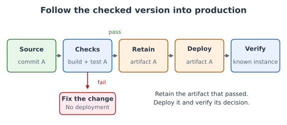
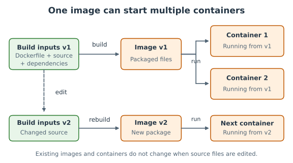
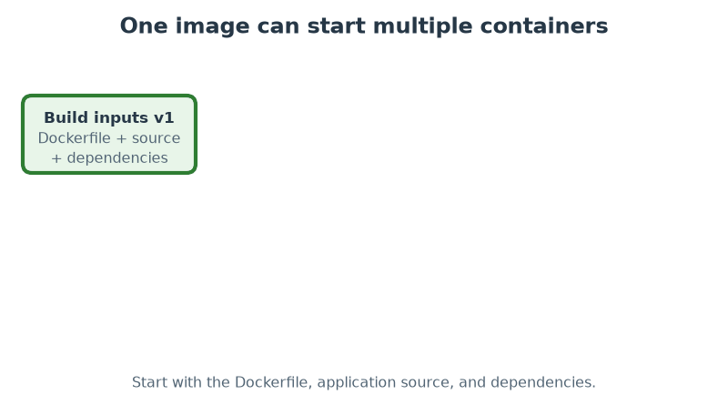
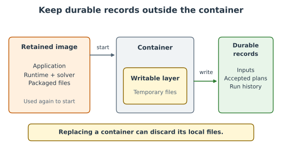
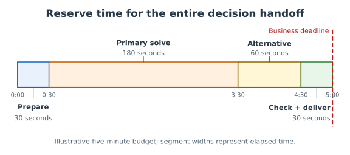
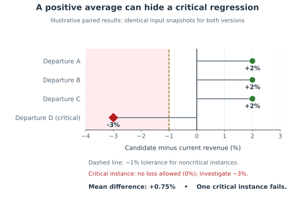
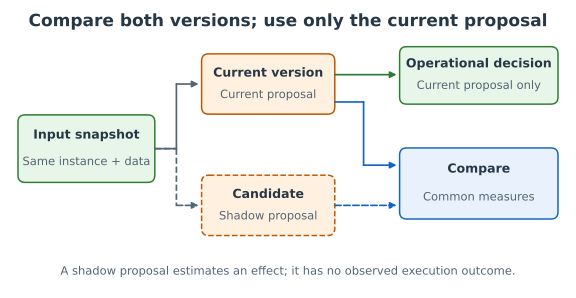
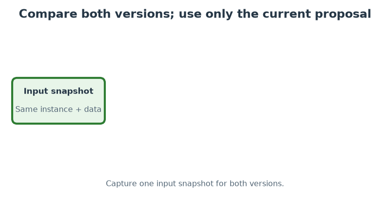

# Chapter 05: Deploying decision-support software

## 1. Introduction

A tested model creates value when somebody can use its decisions. A load planner needs a proposal
before loading begins, with the current bookings and aircraft capacities. Installing a program is
one step toward that outcome. Its dependencies must work where it runs, its answer must arrive in
time, and somebody must respond when it cannot produce an acceptable proposal.

[Deployment](../appendix/glossary.md#deployment) puts software into the environment where people use
it, called [production](../appendix/glossary.md#production). Decision-support software brings a
model, a solver, input data, and business expectations into that environment. **The difference this
chapter addresses:** decision-support software can fail visibly, as when a solver license is
missing, or quietly, its proposals growing poorer while every run succeeds, so a release must be
judged by its decisions as well as by whether the program runs. The path to production includes
assessing changes before release and leaving the system ready to be watched once it runs.

### The cargo example

This chapter continues the [cargo loading example](../appendix/cargo_model_example.md) used in
design and testing. A planner receives a proposal for a departure; the system maximizes revenue
subject to weight, volume, whole-pallet, and commitment constraints. The mathematical model stays
the same unless an example explicitly changes it.

The practice exercise deploys a smaller food-selection application: maximize calories within a
budget and weight limit. Packaging, release assessment, and recovery transfer between the two
models. The exercise lives in the Python training repository; readers deploy their own fork of the
application.

---

## 2. How a decision reaches its users

A load proposal has to reach a planner at the moment they can act on it. A file produced overnight
and a button pressed after a booking changes can both run the same model, but they serve different
work. Start by identifying that work: who asks for a decision, what event makes the inputs ready,
how long the answer remains useful, and who accepts it.

### Three ways to deliver a decision

| Deployment shape          | How it works                                               | When it fits                                      | What the team must specify                                                                  |
| ------------------------- | ---------------------------------------------------------- | ------------------------------------------------- | ------------------------------------------------------------------------------------------- |
| Interactive planning tool | A person starts a run and inspects the result              | Inputs or priorities are adjusted during planning | How the planner sees status, compares proposals, and accepts one                            |
| Scheduled batch run       | A program starts at an agreed time and processes instances | Inputs become ready on a predictable schedule     | Input cutoff, completion deadline, result destination, and failure notification             |
| On-demand service         | Another application sends a request and receives a result  | Decisions are requested as events occur           | Response deadline, handling of simultaneous requests, and how the caller learns the outcome |

A [batch run](../appendix/glossary.md#batch-run) works without a person steering each instance. A
[service](../appendix/glossary.md#service) exposes an operation to another application. Either can
support a planning interface; these shapes can be combined.

Cadence influences the choice, but does not determine it. An annual mine plan can need an
interactive tool for weeks of scenario exploration. A daily cargo operation can use scheduled runs
for routine departures and an interactive tool for exceptions. A disruption-recovery decision can
need a service because the event, rather than the clock, starts the work.

### Specify the handoff

For a cargo departure, a minimal specification says: the booking list closes at an agreed time; the
system uses that list and the assigned aircraft; a proposal reaches the named planner before the
loading cutoff; the planner accepts or changes it; and an unsuccessful run reaches a named person.
It also identifies which proposal is current, so a late result cannot overwrite a newer decision.

A service adds a resource question. If ten requests arrive together, can they all finish before
their deadlines? The design may need to limit simultaneous solves or place requests in a waiting
queue. Infrastructure specialists help implement this; the scientist supplies the deadline and
acceptable behavior when capacity is exhausted.

### Check yourself

1. A monthly decision requires exploration of many scenarios. Does monthly cadence establish that a
   scheduled batch run is the right interface?
2. A correct proposal arrives after loading starts. Was the delivery specification met?

Answers

1. No. Scenario exploration suggests an interactive tool; cadence is only one input.
2. No. The specification includes when the decision must arrive.

---

## 3. From a tested change to a running release

The tests pass on a scientist's laptop. The planner still uses yesterday's version. Between those
facts lie several choices: which files to install, which settings to use, which machine to run on,
and how to establish that the installed program works. Making those choices explicit turns an
installation into a repeatable path.

### Source, checks, package, deployment, verification

[Version control](../appendix/glossary.md#version-control) records changes to files. A
[commit](../appendix/glossary.md#commit) identifies one recorded state. A
[build](../appendix/glossary.md#build) prepares runnable software from that state and its
dependencies; its output is a [build artifact](../appendix/glossary.md#build-artifact), such as an
installable package or [container image](../appendix/glossary.md#container-image). A
[release](../appendix/glossary.md#release) identifies the artifact and configuration approved for
use.

| Step                         | Evidence to retain                          | Question it answers                                |
| ---------------------------- | ------------------------------------------- | -------------------------------------------------- |
| Record the source            | Commit identifier                           | Which change is this?                              |
| Run automated checks         | Results tied to that commit                 | Did this version pass its checks?                  |
| Build and retain the package | Artifact identifier and dependency versions | What will actually run?                            |
| Deploy with configuration    | Deployment identifier and settings          | What is installed where?                           |
| Verify the installed version | Startup check and known-instance result     | Can this deployment deliver the expected decision? |

[Continuous integration](../appendix/glossary.md#continuous-integration) (CI) runs the build and
checks on changes. It makes the tests of Chapter 04 a gate in this path. Keep quick checks and small
solver instances in that gate; schedule expensive experiments separately when necessary. If
production uses a different solver, passing with an open-source solver does not establish that the
production solver and license work. Include that check before release.

[Continuous delivery](../appendix/glossary.md#continuous-delivery) keeps approved changes ready to
deploy through an automated path.
[Continuous deployment](../appendix/glossary.md#continuous-deployment) also deploys automatically
after the gates pass. Neither decides which business changes are acceptable. The product team owns
that judgment, as explained in [9. Staff the team](../07-adopting/README.md#ch-staffing) in
Chapter 07.

Deploy the commit that passed, rather than whatever is newest when deployment starts. Prefer
promoting the checked artifact itself. If a host rebuilds from the checked source, record that
distinction and verify the resulting package: a moving base image or dependency can change a build
without changing the application files.

Follow the identified version in [Figure: checked release path](#fig-checked-release).

**Figure: checked release path**

### Environments and configuration

An [environment](../appendix/glossary.md#environment) combines the resources and settings where the
program runs. Development is where changes are made; a test environment checks them away from users;
production serves the business. Separate testing from current planning when a failed run would
interfere with users.

[Configuration](../appendix/glossary.md#configuration) supplies settings such as input location,
solver choice, and delivery destination. An
[environment variable](../appendix/glossary.md#environment-variable) passes a setting to a process.
A [secret](../appendix/glossary.md#secret), such as a deployment credential, needs controlled
storage and access. Keep it outside source files and built packages. Record which configuration
belongs to the release without copying secret values into reports.

### Retain what recovery needs

A [rollback](../appendix/glossary.md#rollback) restores a previous deployment. Keep its artifact in
an [artifact registry](../appendix/glossary.md#artifact-registry), a store from which an identified
package can be retrieved. Agree how many releases to retain and for how long, then practice
retrieving one. Rebuilding old source is a different operation: external dependencies may change.

Restoring software does not undo a decision already executed. It also does not automatically restore
input data or reverse changes to stored records. Recovery must state which settings and records
remain compatible with the earlier software. The release process returns to this question in
[6. Release a new model safely](#ch-safe-release).

### Further reading

- Humble and Farley,
  [_Continuous Delivery_](https://www.informit.com/store/continuous-delivery-reliable-software-releases-through-9780321601919),
  explains how checks, packages, and environments form a repeatable delivery process.
- McNutt,
  ["Release Engineering" in _Site Reliability Engineering_](https://sre.google/sre-book/release-engineering/),
  develops the relationship between identified source, repeatable builds, and releases.
- Gene Kim, Jez Humble, Patrick Debois and John Willis, _The DevOps Handbook_, IT Revolution Press,
  2016, chapters 9, "Create the Foundations of Our Deployment Pipeline", and 12, "Automate and
  Enable Low-Risk Releases": the deployment pipeline as the core practice of flow, the first of the
  Three Ways.

---

## 4. Package the model with its solver

A colleague opens the cargo program on another machine and cannot start it. The source files are
present, but the solver library is missing. Installing it exposes a second problem: the machine
cannot obtain a license. The runnable system includes more than the files the team wrote, so its
package and operating requirements must describe that larger whole.

### Identify the runnable system

List the language runtime, libraries, solver version, and operating-system requirements alongside
the application and model. A [pinned environment](../appendix/glossary.md#pinned-environment)
records the versions used. Include solver parameters and input format in the
[release](../appendix/glossary.md#release) [configuration](../appendix/glossary.md#configuration).
When data arrives separately, document how it is obtained and which snapshot each run used.

Version pinning reduces accidental changes; it does not promise the same selected pallets on every
machine. Different optimal loads can have the same revenue, and time-limited searches can depend on
hardware, parallel execution, and random choices. A solver upgrade deserves release assessment even
when no formulation changes.

For a commercial solver, establish how the license applies to the intended machines and simultaneous
solves. A [license server](../appendix/glossary.md#license-server) supplies permission to use
licensed software. Check connectivity and capacity where the system will run. Some licenses use
another arrangement; consult the actual terms rather than assuming laptop permission extends to
hosting.

### An image and a running container

A [container image](../appendix/glossary.md#container-image) packages application files, a runtime,
and dependencies. A [container](../appendix/glossary.md#container) is a running instance created
from that image, with its own processes and writable filesystem. Multiple containers can start from
the same image. Stopping one does not change the image it came from.

Docker is a tool for building images and running containers. A
[Dockerfile](../appendix/glossary.md#dockerfile) describes how an image is built. The supplied
Python exercise already has one: readers inspect and use it rather than write a new one.

| Dockerfile responsibility  | Why the application needs it                               |
| -------------------------- | ---------------------------------------------------------- |
| Choose a base image        | Supply operating-system userspace and the language runtime |
| Install dependencies       | Include optimization and web libraries                     |
| Copy application files     | Put the model and its surrounding software in the package  |
| Define the startup command | Start the process that receives requests                   |

Building executes the packaging instructions and produces an image. Running starts a container from
that image. Source edits on the laptop do not alter an existing image; rebuild after changing
source, dependencies, or packaging instructions. A startup setting may instead require restarting
with new configuration.

[Figure: image and container lifecycle](#fig-image-lifecycle) tracks packages and running instances
through a source edit.

**Figure: image and container lifecycle**

Watch the build, run, and rebuild sequence

The optional [Figure: image lifecycle sequence](#fig-image-lifecycle-animation) animates the same
sequence.

**Figure: image lifecycle sequence**

### Make the container reachable

A web application listens on a [port](../appendix/glossary.md#port), a numbered network endpoint.
Running locally requires mapping a host port to the container's listening port. On a deployment
host, the process must listen on an address and port the host can reach. Declaring a port in the
image describes an intention; it does not by itself publish the port.

Pass runtime configuration through the host's settings or environment variables. Keep license
credentials and deployment secrets outside the image. Inspect [logs](../appendix/glossary.md#log),
records of events emitted by the program, when startup or a solve fails. A
[health check](../appendix/glossary.md#health-check) can establish that the web process responds. A
known optimization instance additionally checks that it can produce a valid decision.

### Separate a package from durable records

An image can contain sample inputs. Production inputs, accepted plans, and investigation records
usually need a separate storage policy. Files written into a container's writable layer can
disappear when the container is replaced. Put records that must survive in storage whose retention
and access the team has specified.

The storage boundaries are shown in
[Figure: durable records outside the container](#fig-durable-records).

**Figure: durable records outside the container**

Containers package an execution environment; they share the host's operating-system kernel and
remain subject to its resource limits. Check target compatibility, memory, solver licensing, and
startup behavior. Local success is evidence to carry into deployment verification.

### Check yourself

1. You edit a formulation and restart a container from yesterday's image. Which formulation runs?
2. A web health check succeeds. Does that establish that the solver license is available?
3. A result exists only inside a replaced container. Has it been retained for investigation?

Answers

1. Yesterday's formulation. Rebuild the image to include the edit.
2. Only if the check explicitly exercises that dependency. Verify a known solve as well.
3. No. Retention requires storage that survives replacement.

---

## 5. Plan for runs that end badly

A load planner has to act before the aircraft departs. A search that eventually finds a better load
can still be useless after loading starts. Agree when the proposal must arrive and what makes it
acceptable; then allocate time across the work needed to deliver it.

### Budget the whole run

For an illustrative five-minute delivery window, reserve 30 seconds for obtaining and checking data,
three minutes for the primary solve, one minute for an alternative, and 30 seconds for checking and
delivering the proposal. These allocations are business-specific. Measure them on representative
inputs before relying on them.

[Figure: delivery deadline](#fig-delivery-deadline) places these allocations on one proportional
timeline.

**Figure: delivery deadline**

A solver [time limit](../appendix/glossary.md#time-limit) controls one search, not the entire run.
Data retrieval, model construction, waiting for resources, and delivery consume time too. Arrange an
overall deadline and reserve time for the agreed response. Failed solver startup must still leave
enough time for that response.

### Distinguish the condition from the response

The cargo [contract](../appendix/glossary.md#contract) distinguishes `optimal`, `feasible`,
`infeasible`, and `not_found`. A time limit is a termination reason: it can leave a feasible load or
no load. The business response depends on what exists at termination, not just why search stopped.

A [fallback](../appendix/glossary.md#fallback) is an alternative action when the primary path cannot
deliver its promise. The table is an example policy to agree with the cargo planner, not a universal
order of alternatives.

| Condition                                  | Example agreed response                                                                         | Evidence needed before acting                                    |
| ------------------------------------------ | ----------------------------------------------------------------------------------------------- | ---------------------------------------------------------------- |
| Invalid or incomplete inputs               | Ask the data owner to correct them; notify the planner                                          | Which required field or business check failed                    |
| Infrastructure or license failure          | Retry within the remaining budget; otherwise use an approved alternative or contact the planner | Failure reason, time left, alternative availability              |
| Proven infeasibility                       | Ask the planner to resolve conflicting commitments or capacities                                | Proof status and conflicting inputs where available              |
| Search ends without a load or proof        | Run an approved heuristic if time remains; otherwise escalate                                   | No solution found distinguished from no solution possible        |
| Feasible load, optimality unproven         | Accept only if agreed validity and quality criteria hold                                        | Checked constraints, available quality bound, delivery time left |
| Earlier proposal offered as an alternative | Revalidate against current bookings and aircraft                                                | Current commitments and capacities, plus proposal age            |

A [heuristic](../appendix/glossary.md#heuristic) can find a useful candidate without proving it
best. Its output needs the same validity checks as any proposal. Yesterday's plan needs checking
too: the aircraft or committed freight may have changed.

No policy can promise a loadable plan when commitments cannot fit. Timely human intervention is then
the useful result. Give the planner a clear outcome and enough context to act, rather than
disguising an empty result as success or relaxing commitments without permission.

### Check yourself

1. Search reaches its time limit without a proposal. May it report proven infeasibility?
2. Today's aircraft is smaller. May yesterday's high-revenue load be reused without checking it?

Answers

1. No. Search termination without a solution is not proof that none exists.
2. No. A reused plan must meet today's constraints and commitments.

---

## 6. Release a new model safely

A change passes every correctness test, yet returns poorer loads within the available time. Those
tests established the promises they checked. They did not necessarily establish acceptable quality
under operating conditions. Before replacing a working version, gather evidence about the effects
the change can have.

### Declare the expected effects

Make the change on a [branch](../appendix/glossary.md#branch), a separate line of work. Record the
current and candidate [commits](../appendix/glossary.md#commit), then state the hypothesis. A
display change should preserve decision measures. A solver change should preserve feasibility and
acceptable quality, but can alter selected pallets or solve time. A new business rule can
intentionally alter both.

Choose [acceptance criteria](../appendix/glossary.md#acceptance-criteria) with the business: which
measures should improve, which should stay stable, how much variation is acceptable, and which
instances must never regress. Record these before seeing the candidate's results.

### Compare the same instances

The [benchmark](../appendix/glossary.md#benchmark) of
[10. Testing a mixed-integer program without optimality guaranteed](../04-testing/README.md#ch-mip-no-optimality)
in Chapter 04 tracks solution quality. A release experiment extends it to compare a feature branch
with the current version on **exactly the same sample of instances and input snapshots**. Include
routine, difficult, and critical instances. The sample is evidence about those conditions, not a
guarantee about every future departure.

Hold runtime environments and solve budgets comparable. Record intentional differences, such as the
solver under evaluation, and keep other settings fixed where possible. If solver variability
matters, repeat both versions under documented conditions. Comparing a laptop with a hosted machine
confounds software effects with environment effects.

Report feasibility, revenue, delivery time, and other measures the change can affect for each
instance. Inspect paired differences before their aggregate. A better mean can hide a critical
departure that now misses its deadline.

| Change                | Expected effect                               | Release evidence                                               |
| --------------------- | --------------------------------------------- | -------------------------------------------------------------- |
| Display-only feature  | Load measures stay stable                     | Same-instance measures within the declared tolerance           |
| Solver upgrade        | Valid loads; acceptable quality and deadlines | Paired feasibility, revenue, timing, and quality-bound results |
| New objective penalty | Trade-offs change intentionally               | Both versions evaluated with common business measures          |

If the objective definition changes, its raw values may cease to be comparable. Evaluate both loads
with common business measures, such as revenue carried and shipments affected. An objective with a
new penalty is not directly comparable to revenue alone.

### Investigate unexpected differences

In an illustrative cargo experiment, the planner could require zero invalid loads and no revenue
loss on named critical instances, permit at most 1% loss elsewhere, and require every sampled
proposal within the delivery window. These are example criteria, not universal airline thresholds.

In [Figure: paired release differences](#fig-paired-release-differences), three departures gain 2%
each, but a critical departure loses 3%. The mean gain of 0.75% hides that critical regression.
Check exact inputs, active settings, solver conditions, and decisions before deciding whether the
change caused the difference.

**Figure: paired release differences**

> [!NOTE]
>
> These illustrative values explain the acceptance decision; they are not measured exercise results.

Business significance asks whether a difference matters operationally. Statistical significance asks
whether observations are consistent with a stated model of variability. A tiny, repeatable change
can be statistically detectable and harmless; a large loss on one critical departure can matter
before a broad statistical claim is justified. Use business tolerances first and analyze variability
when it affects the conclusion.

Keep tests and experiment reports distinct. A test of a promised invariant can fail automatically. A
benchmark report can call for judgment without every difference becoming a failed test. Stable
business criteria can later become automated release gates.

### Add shadow runs when the risk warrants them

A [shadow run](../appendix/glossary.md#shadow-run) gives the candidate the current version's inputs
but keeps its output away from the operational decision. It checks current conditions a historical
sample may miss. Record both input snapshots, compare using agreed measures, and isolate extra
compute so it cannot delay the current service.

Trace the shared input and the two output destinations in
[Figure: shadow-run data flow](#fig-shadow-flow).

**Figure: shadow-run data flow**

Watch the shadow-run sequence

The optional [Figure: shadow-run sequence](#fig-shadow-flow-animation) animates the same sequence.

**Figure: shadow-run sequence**

Use shadow runs proportionately. A frequent, time-critical solve may justify several cycles. An
infrequent planning tool may need offline experiments and planner review instead. A shadow proposal
has not been executed; its predicted business effect is not an observed outcome.

### Approve, verify, and recover

The scientist and business reviewer assess the paired report before merging. Automated checks then
gate deployment. A [health check](../appendix/glossary.md#health-check) establishes the operational
facts it actually checks; a known-instance solve adds decision verification. Confirm the installed
version and active settings, and watch the agreed measures after release.

Prepare a [rollback](../appendix/glossary.md#rollback) before switching. Identify the earlier
artifact, compatible configuration, recovery owner, and symptoms triggering recovery. Practice
restoring it and verifying a known instance. Then reconcile the source branch and host settings so
the next automatic deployment does not reintroduce the problem. Accepted or executed plans need a
separate business response.

### Check yourself

1. Both versions ran 100 instances, sampled from different months. Does that isolate release
   effects?
2. Two valid loads have different pallets and the same revenue. Is that alone a regression?
3. The candidate adds a penalty. Can its objective be compared directly with revenue alone?

Answers

1. No. Use the same instances and snapshots in both runs.
2. No. Evaluate differences against business criteria; multiple optima can exist.
3. No. Use common business measures to assess the changed trade-offs.

> **Practice it** Python:
> [Release a new model safely exercise](https://github.com/sefop/training-testing-python/tree/main/src/safe_release).
> Build and run the supplied Docker image, deploy your fork on Render, compare a solver change on
> the same instance sample, release after checks pass, and recover the earlier deployment.

---

## 7. Conclusion

A deployment succeeds when the business receives an acceptable decision in time, and the team is
ready to establish whether that remains true as the software and business change.

- **Start from the decision handoff** ([2. How a decision reaches its users](#ch-delivery-shape)).
  Cadence, interaction, and deadlines together shape delivery.
- **Identify the path from change to release**
  ([3. From a tested change to a running release](#ch-release-path)). Retain checked source,
  artifacts, settings, and verification evidence.
- **Package the execution requirements** ([4. Package the model with its solver](#ch-packaging)).
  Specify the runtime, solver, licensing, and configuration.
- **Agree what unsuccessful runs mean** ([5. Plan for runs that end badly](#ch-run-failures)).
  Validate alternatives and escalate when there is no acceptable proposal.
- **Compare the same instances before switching**
  ([6. Release a new model safely](#ch-safe-release)). Assess expected effects and practice
  recovery. Use these questions to review a deployment with business and platform specialists.
  [Chapter 06](../06-operating/README.md) follows the release into operation: watching each run and
  following its decisions into use.

---

[← Book contents](../../README.md) ·
[Next chapter: 06 Operating and evaluating decision-support software →](../06-operating/README.md)
