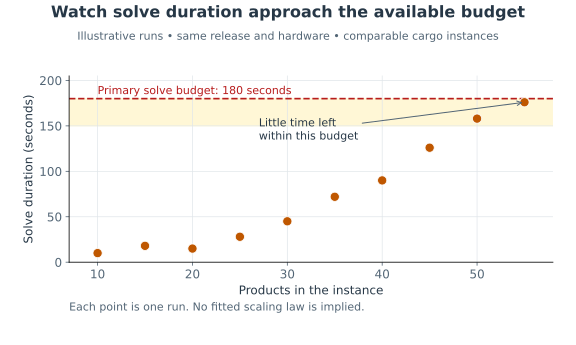
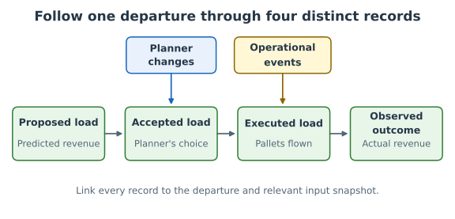

# Chapter 06: Operating and evaluating decision-support software

## 1. Introduction

A scientist trusts an experiment only after checking what it measured. A decision-support system
repeats an experiment every day: each run turns the current data into a proposal, and the business
acts on it. A release that passed every check before deployment still meets data, demand and
planners it has never seen. Whether its decisions stay correct, timely and useful can only be
established while it runs.

[Monitoring](../appendix/glossary.md#monitoring) watches a running system, and for decision-support
software it has to watch two things: how each run reached its result, and what the business did with
it. **The difference this chapter addresses:** ordinary software is healthy when it answers
correctly and on time, while a decision-support system can run without a single error and still
deliver decisions that nobody uses or that quietly get worse. Its operation ends at the outcome of
the decision, not at the delivered answer. This is the second of the
[Three Ways](../appendix/glossary.md#three-ways), feedback, which Kim, Humble, Debois and Willis
(2016) develop from chapter 14, "Create Telemetry to Enable Seeing and Solving Problems", onward.
This chapter continues the [cargo loading example](../appendix/cargo_model_example.md) of
[Chapter 05](../05-deployment/README.md).

### Ideas to develop

- **Changes in inputs and outputs.** The distribution and magnitude of decisions, outliers among
  outputs, how sparse the decisions are, and how much a plan changes between consecutive runs on
  nearly identical inputs. Input drift is measured against the instances the model was tested on.
- **Infeasibility as a signal.** A rising share of infeasible instances says something about the
  data or the business rules, not only about one run.
- **From alert to verified correction.** Reproduce the run from its investigation record, diagnose,
  correct through the normal delivery path
  ([8. Fix a bug together](../07-adopting/README.md#ch-bug-protocol) in Chapter 07), verify, and
  close the alert.
- **Learning from operational failures.** A review that asks how the system let the failure happen,
  not who caused it, and turns the answer into a check or a change.
- **Periodic value review.** Compare the decisions with the comparator and success criteria agreed
  before development, ask whether the system still justifies its maintenance, and end in one of
  three outcomes: keep investing, change the requirements, or retire the system.

### Sections

|  #  | Section                                                            | After it you can…                                                                                   | Status      |
| :-: | ------------------------------------------------------------------ | --------------------------------------------------------------------------------------------------- | ----------- |
|  1  | [Introduction](#ch-introduction)                                   | Say what operating a decision-support system adds to running it                                     | Ready       |
|  2  | [Measure the health of every run](#ch-run-health)                  | Choose execution, solver and input signals that lead to an action, and alert the person who can act | Ready       |
|  3  | [Measure the quality of the decisions](#ch-decision-quality)       | Follow a decision from proposal to outcome, and read overrides with their reasons                   | Ready       |
|  4  | [Detect changes in inputs and outputs](#ch-change-detection)       | Notice when the data or the decisions drift away from what the model was tested on                  | Coming soon |
|  5  | [Investigate from alert to verified correction](#ch-investigation) | Take an alert through diagnosis and correction to a verified fix, and keep what the team learned    | Coming soon |
|  6  | [Review the value of the system](#ch-value-review)                 | Decide with the business whether to keep investing, change the requirements or retire the system    | Coming soon |
|  7  | [Conclusion](#ch-conclusion)                                       | Recall in one page what to watch after release, and what each signal can establish                  | Ready       |

---

## 2. Measure the health of every run

Yesterday's cargo run met its deadline. Today's finished too, but only just. If the team records
success alone, growing pressure stays invisible until a proposal arrives too late. Record signals
that explain how a run reached its result, and watch trends while there is time to respond.

[Monitoring](../appendix/glossary.md#monitoring) watches signals during operation. Decision-support
software needs execution, solver, and input signals, as well as the measures developed in
[3. Measure the quality of the decisions](#ch-decision-quality). Ordinary software can also need all
these concerns; optimization gives search progress a particular role.

### Signals that lead to an action

| Layer     | Signals                                                                           | Cargo interpretation                                       | Investigation or action                                                             |
| --------- | --------------------------------------------------------------------------------- | ---------------------------------------------------------- | ----------------------------------------------------------------------------------- |
| Execution | Duration, waiting time, memory, completion and delivery status                    | Proposals arrive late despite quick solves                 | Infrastructure owner checks waiting and delivery; scientist reviews the time budget |
| Solver    | Termination reason, feasibility, time to first feasible load, objective and bound | More searches end without a load or with weaker guarantees | Scientist examines difficult instances and settings                                 |
| Input     | Missing fields, freshness, products and commitments, unusual capacities           | A feed omits commitments or changes units                  | Data owner checks the feed; planner confirms business meaning                       |

A time limit is a termination reason; feasibility describes what search found. Record both. Mark
results from the primary solve, an alternative, and human escalation separately, so successful
alternatives cannot hide a worsening primary path.

Where a solver supplies a valid bound, its [gap](../appendix/glossary.md#optimality-gap) measures
the distance between the best feasible objective and bound under a stated convention. Record its
convention, objective scale, and termination reason. A small gap does not establish that the model
captures the business. Some heuristics supply no bound; retain missing measurements as missing, not
zero.

### Watch growth before a deadline is missed

More products or commitments can increase the work a run needs. Plot or tabulate instance size
against solve duration and time to first feasible load. Compare similar groups and the same release;
formulation and hardware changes affect trends too. Difficulty does not grow in a fixed proportion
to instance size.

[Figure: instance size and solve duration](#fig-instance-growth) shows comparable runs approaching
the primary solve's budget. Its 180-second boundary corresponds to the allocation in
[Figure: delivery deadline](../05-deployment/README.md#fig-delivery-deadline) in Chapter 05.

**Figure: instance size and solve duration**

> [!NOTE]
>
> Each point is one illustrative run. The plot does not establish a scaling law or a release effect.

If large departures leave little time for the alternative path, act before missing the deadline. The
response may be more compute, a formulation improvement, a different time allocation, or an earlier
input cutoff. Monitoring reveals pressure; the team chooses the response.

### Retain an investigation record

Give each run an identifier. Retain release and artifact identifiers, active configuration, input
snapshot reference, solver version and parameters, random seed where applicable, relevant hardware
and parallelism settings, timings, termination reason, and delivered result. A
[log](../appendix/glossary.md#log) links events to that run. A snapshot retains the actual data, not
a filename whose contents later change.

Record fallback use and planner acceptance separately. Specify retention and access for inputs and
plans, and protect secrets. These records support investigation and attempted reproduction; they
cannot guarantee identical behavior from a time-limited parallel search on different hardware.

### Notify the person who can respond

An [alert](../appendix/glossary.md#alert) calls for a response. Specify its condition, owner, time
to act, and first investigation step. Failure to deliver before the cargo cutoff deserves immediate
attention. Worsening solve-time trends can be a scheduled scientist review. License connectivity
failure goes to the platform owner with affected run identifiers.

Avoid alerting on every variation. Measurement history remains useful even when a change does not
require an immediate interruption.

### Further reading

- Ewaschuk,
  ["Monitoring Distributed Systems" in _Site Reliability Engineering_](https://sre.google/sre-book/monitoring-distributed-systems/),
  explains how signals, symptoms, and actionable alerts serve different purposes.

---

## 3. Measure the quality of the decisions

A proposal respects every modeled constraint and reaches the planner on time. The planner changes
half of it before loading. Operational health established that the system delivered its computed
answer. Learning whether that answer serves the business requires following the decision further.

### Follow proposal, execution, and outcome

Keep the proposed load, accepted load, load actually flown, and observed outcome distinguishable.
Link them to the departure and input snapshot. The objective is the model's estimate of a proposal's
value. Actual revenue can differ because bookings change, freight misses the cutoff, or the proposal
is overridden.

[Figure: decision lineage](#fig-decision-lineage) places the records and intervening changes along
the decision's path.

**Figure: decision lineage**

| Stage      | Example measure                                                       | What it can establish                        |
| ---------- | --------------------------------------------------------------------- | -------------------------------------------- |
| Proposal   | Revenue against a comparable baseline; gap where a valid bound exists | Predicted quality under recorded assumptions |
| Acceptance | Overrides and their reasons                                           | Where the planner changes the proposal       |
| Execution  | Pallets proposed versus pallets actually flown                        | Whether the accepted plan was implemented    |
| Outcome    | Observed revenue and commitments met                                  | What happened in the business                |

A [baseline](../appendix/glossary.md#baseline) is a reference for comparison, such as the current
release's proposal or an agreed simple planning method. Use the same inputs and business measures
when comparing proposals. Comparing this month's revenue with last month's without considering
demand, aircraft, and price changes does not isolate model quality.

### Interpret overrides with their reasons

The [override rate](../appendix/glossary.md#override-rate) is the share of proposals changed before
acceptance, using a stated denominator and definition of a change. Record magnitude too: moving one
pallet and replacing most of the load are different events.

A rising rate is a question to investigate, not proof of a bad model. A planner may know about a
late cancellation, missing business rule, or constraint outside the intended scope. They may also
distrust an unfamiliar selection among equally good loads. Group reasons and inspect examples with
planners before changing the formulation.

An unchanged rate can hide declining use if planners abandon the system. Track the proportion of
eligible departures for which a proposal is requested, accepted, and executed. Keep that population
stable or explain changes to it.

### Separate a release effect from a changing business

Suppose observed revenue falls after a release. Inspect whether demand or prices fell, whether
similar departures are represented, and whether proposal quality changed on comparable inputs. Then
inspect overrides and execution. A paired offline experiment isolates effects on computed proposals;
production observations include the surrounding business.

For an important claim about realized improvement, design a business-approved experiment with
comparable conditions and account for interactions between decisions. Running a shadow proposal
cannot establish the outcome that would have occurred had it been executed.

### Review quality over time

Review [monitoring](../appendix/glossary.md#monitoring) measures regularly with scientists and
business users. Investigate changes by release, instance group, and override reason. Revisit
[acceptance criteria](../appendix/glossary.md#acceptance-criteria) when expectations change; retain
earlier criteria with the release they governed.

Delivery measures such as release frequency, time to release a change, failed changes, and recovery
time help assess engineering. Decision measures assess whether delivered proposals serve users.
Review both, with enough context to explain their movement.

### Check yourself

1. The objective improves, but actual revenue falls. Does that prove the release harmed the
   business?
2. Overrides rise after a new aircraft type enters service. What should the team investigate?
3. Nobody overrides, but half the eligible departures never request a plan. Is override rate enough?

Answers

1. No. Inspect comparable proposals, changing inputs, acceptance, and execution before attribution.
2. Review new aircraft inputs, modeled constraints, override reasons, and affected plans with users.
3. No. Measure use across eligible departures as well as overrides among requested proposals.

---

## 4. Detect changes in inputs and outputs

A run can be healthy and its decisions accepted while the data feeding it slowly leaves the range
the model was tested on. The section will develop how to describe the instances and decisions a
release was assessed on, and how to notice when production moves away from them: in the inputs, in
the distribution and sparsity of the decisions, and in how much a plan changes between runs on
nearly identical data.

---

## 5. Investigate from alert to verified correction

An alert is the start of an investigation, not its end. The section will follow one alert through
reproduction from the investigation record, diagnosis, a correction delivered through the normal
release path, and verification. It will close with a review that asks how the system allowed the
failure, so that the lesson becomes a check rather than a memory.

---

## 6. Review the value of the system

A system that runs well can still stop being worth its maintenance. The section will develop a
periodic review with the business: decisions compared with the comparator agreed before development,
the cost of keeping the system alive, and a decision among three outcomes: keep investing, change
the requirements, or retire it.

---

## 7. Conclusion

Operating decision-support software means following each decision past its delivery, into use and
outcome, and acting on what that reveals.

- **Watch the path to the result** ([2. Measure the health of every run](#ch-run-health)).
  Execution, solver, and input signals make emerging problems investigable.
- **Follow decisions into use** ([3. Measure the quality of the decisions](#ch-decision-quality)).
  Proposals, overrides, execution, and observed outcomes tell different parts of the story.
- **Notice drift early** ([4. Detect changes in inputs and outputs](#ch-change-detection)). Compare
  production with the instances a release was assessed on.
- **Close the loop on every alert**
  ([5. Investigate from alert to verified correction](#ch-investigation)). A verified fix and a
  lasting check are the end of an investigation.
- **Keep justifying the system** ([6. Review the value of the system](#ch-value-review)). Decide
  with the business whether to keep investing, change the requirements, or retire it.

[Chapter 07](../07-adopting/README.md) turns from one system to the team: how it adopts these
practices, whether it starts from a new system or an inherited one.

---

[← Book contents](../../README.md) ·
[Next chapter: 07 Adopting DecisionOps →](../07-adopting/README.md)
